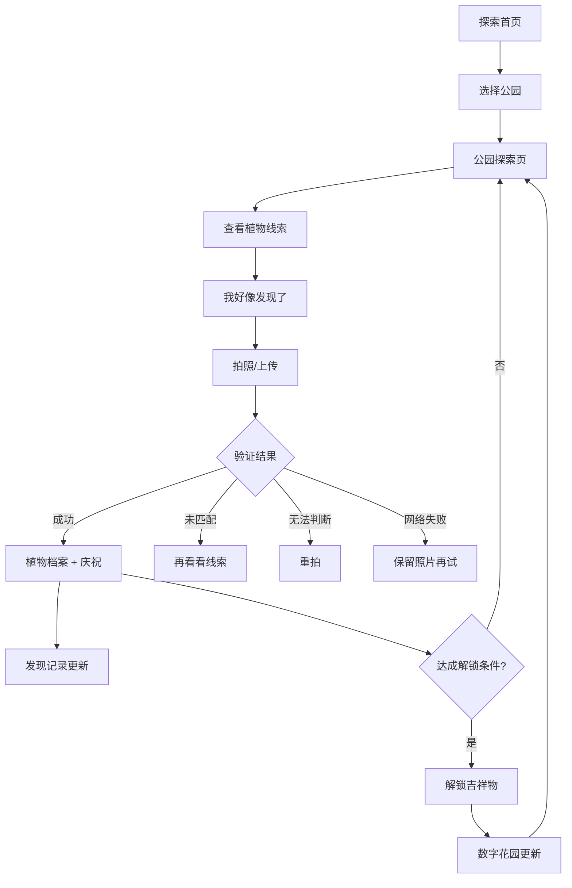

# Park Buddies 产品需求文档

## 1. 产品概述

Park Buddies 是一款通过"好奇心"鼓励居民走进上海公园、观察植物、探索不同角落的互动应用。核心体验循环:产生好奇 → 进入公园 → 自由探索 → 注意到植物 → 拍照验证 → 了解植物 → 解锁伙伴 → 继续探索。

- 面向上海城市居民,以观察和发现为核心,不做倒计时、强制打卡、步数排名或竞争排行榜
- 产品重点是现实中的观察和发现,吉祥物、收藏和数字花园是探索后的延续
- 目标:让用户因为好奇而观察公园,让数字花园记录他们在真实世界中的发现

## 2. 核心功能

### 2.1 用户角色

| 角色 | 注册方式 | 核心权限 |
|------|----------|----------|
| 访客(本地身份) | 无需注册,自动生成本地身份 | 浏览公园、拍照验证、解锁档案、数字花园 |
| 登录用户(预留) | 账号同步(后续接入) | 数据云端同步 |

### 2.2 功能模块

1. **探索首页**:公园地图/列表视图、公园卡片、搜索筛选、附近公园提示
2. **公园探索页**:公园主题色、地图、植物线索卡片、发现进度、吉祥物
3. **植物线索页**:剪影/局部特征、模糊线索文案、拍照入口
4. **拍照与验证页**:后置摄像头拍摄、相册上传、验证状态机、演示模式
5. **发现成功页与植物档案**:庆祝动效、植物信息、知识来源、奖励进度
6. **Park Buddies 吉祥物**:三态(未认识/熟悉/解锁)、原创插画、解锁配置
7. **我的数字花园**:已解锁伙伴、植物装饰、收藏区域、最近变化
8. **发现记录**:按公园筛选、照片/植物/时间
9. **我的**:昵称、统计、权限说明、演示模式提示、删除记录入口

### 2.3 页面详情

| 页面名称 | 模块名称 | 功能描述 |
|----------|----------|----------|
| 探索首页 | 地图视图 | 示意地图/真实地图适配层,公园标记 |
| 探索首页 | 列表视图 | 公园卡片(名称、区域、距离、发现数量、吉祥物剪影) |
| 探索首页 | 搜索筛选 | 按名称搜索、按行政区筛选 |
| 公园探索页 | 公园主题 | 主题色、介绍、视觉氛围 |
| 公园探索页 | 植物线索 | 未发现植物不显示精确位置的线索卡片 |
| 公园探索页 | 发现进度 | 可发现数量、已发现数量 |
| 公园探索页 | 吉祥物 | 剪影/部分/完整形象 |
| 植物线索页 | 模糊线索 | 局部轮廓、叶片/树皮/花朵特征、简短描述 |
| 植物线索页 | 拍照入口 | "我好像发现了"进入拍照 |
| 拍照验证页 | 拍摄能力 | 后置摄像头、预览、重拍、提交、相册上传 |
| 拍照验证页 | 验证状态 | 等待/预览/提交中/成功/未匹配/无法判断/网络失败 |
| 发现成功页 | 植物档案 | 名称、照片、公园、时间、有趣知识、下次观察 |
| 发现成功页 | 奖励进度 | 花园元素/伙伴进度,首次奖励只发放一次 |
| 数字花园 | 伙伴展示 | 已解锁伙伴、来源公园、解锁发现 |
| 数字花园 | 花园元素 | 来自不同公园的植物或装饰 |
| 发现记录 | 记录列表 | 按公园筛选,照片、植物、时间 |
| 我的 | 统计信息 | 去过公园、已发现植物、已认识伙伴 |
| 我的 | 权限管理 | 定位和照片权限说明、删除记录入口 |

## 3. 核心流程

用户打开探索首页,浏览上海公园 → 选择公园进入探索页 → 查看植物线索 → 点击"我好像发现了"进入拍照页 → 拍摄或上传照片 → 提交验证 → 验证成功展示植物档案与庆祝动效 → 解锁植物进入发现记录 → 达成条件解锁公园吉祥物 → 数字花园更新 → 继续探索。

## 4. 用户界面设计

### 4.1 设计风格

- **主色调**:鼠尾草绿(#7C9885)、奶油白(#FAF7F0)、浅土色(#D4C5A9),少量淡黄色(#F0D77B)点缀
- **按钮风格**:圆角胶囊按钮,柔和阴影,适合单手操作
- **字体**:中文圆润但不过于可爱的字体,标题略带手写质感,正文易读
- **布局**:圆角卡片、清晰留白、柔和阴影,移动端优先
- **插画**:原创、温暖、简洁的植物插画,SVG/CSS 实现
- **氛围**:像一本可以互动的公园观察手册

### 4.2 页面设计概览

| 页面名称 | 模块名称 | UI 元素 |
|----------|----------|----------|
| 探索首页 | 头部 | 品牌名、视图切换按钮 |
| 探索首页 | 公园卡片 | 圆角卡片、吉祥物剪影、发现文案、距离 |
| 探索首页 | 搜索栏 | 名称搜索、行政区筛选 chips |
| 公园探索页 | 主题头部 | 公园主题色背景、名称、吉祥物 |
| 公园探索页 | 线索卡片 | 剪影占位、模糊线索文字 |
| 植物线索页 | 剪影区 | 大面积留白、局部轮廓 |
| 拍照验证页 | 拍摄区 | 全屏取景框、拍摄提示 |
| 发现成功页 | 庆祝区 | 轻量动效、植物照片、信息卡 |
| 数字花园 | 花园场景 | 伙伴排列、植物装饰、轻动画 |
| 我的 | 统计卡 | 数字突出、标签简洁 |

### 4.3 响应式

- 移动端优先(手机尺寸 375-430px),单手操作友好
- 底部导航固定,主要操作按钮可达
- 无横向溢出,图片压缩避免性能问题
- 动效轻量,尊重 `prefers-reduced-motion`

## 5. 演示模式说明

- 无 API Key 或后端时,提供明确标注的演示模式
- 演示数据、演示地图、模拟识别结果必须清楚标注
- 演示解锁与正式收藏分开保存
- 真实服务接入后,验证和奖励判定应在服务端执行
