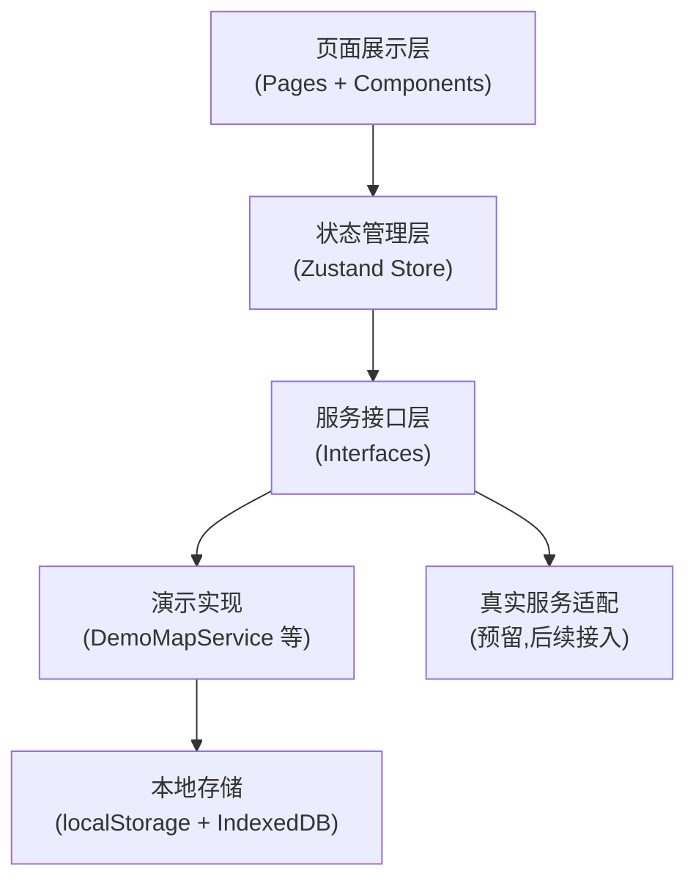
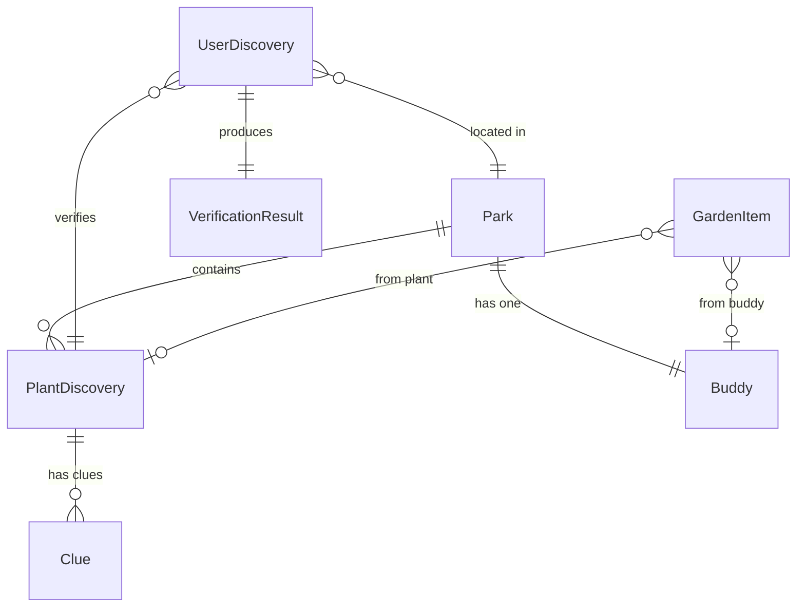

# Park Buddies 技术架构文档

## 1. 架构设计

采用分层架构:页面展示层 → 状态管理层(Zustand)→ 服务接口层(地图/定位/识别/存储)→ 演示实现/真实服务。MVP 阶段无后端,通过服务接口层隔离真实服务,后续可替换演示实现。

## 2. 技术栈说明

* **前端**: React 18 + TypeScript + Vite

* **样式**: Tailwind CSS 3

* **状态管理**: Zustand

* **路由**: react-router-dom

* **图标**: lucide-react

* **后端**: 无(MVP 阶段),服务接口预留后续接入

* **数据存储**: localStorage(结构化数据) + IndexedDB(照片)

* **初始化工具**: vite-init (react-ts 模板)

## 3. 路由定义

| 路由                                  | 页面               | 用途             |
| ----------------------------------- | ---------------- | -------------- |
| `/`                                 | 重定向 → `/explore` | 默认进入探索         |
| `/explore`                          | 探索首页             | 公园地图/列表、搜索筛选   |
| `/park/:parkId`                     | 公园探索页            | 公园主题、线索卡片、发现进度 |
| `/park/:parkId/clue/:plantId`       | 植物线索页            | 模糊线索、拍照入口      |
| `/park/:parkId/verify/:plantId`     | 拍照验证页            | 拍摄/上传、验证状态机    |
| `/park/:parkId/discovered/:plantId` | 发现成功页            | 植物档案、庆祝、奖励     |
| `/garden`                           | 我的数字花园           | 伙伴、植物装饰、收藏     |
| `/records`                          | 发现记录             | 按公园筛选的发现记录     |
| `/profile`                          | 我的               | 昵称、统计、权限、删除记录  |

## 4. 服务接口层设计

无后端 API,通过 TypeScript 接口隔离可替换服务:

* `MapService`:获取公园边界、渲染地图(演示用示意底图,真实接入地图 SDK)

* `LocationService`:获取用户前台定位(演示返回固定坐标,真实用 Geolocation API)

* `PlantIdentificationService`:提交照片识别(演示返回模拟结果,真实通过后端代理调用识别 API)

* `DataStorageService`:公园数据导入接口(JSON/CSV/GeoJSON 校验)、用户数据持久化

## 5. 数据模型

### 5.1 数据模型定义

### 5.2 核心数据结构

* **Park**:id、name、district、intro、lng、lat、boundary、mapSource、plants\[]、buddy、themeColor、dataUpdatedAt、dataSource

* **PlantDiscovery**:id、parkId、name、scientificName、clues\[]、knowledge、knowledgeSource、funFact、nextObserve、isSeasonal、seasonMonths、unlockReward

* **Clue**:id、type(silhouette/leaf/bark/flower/description)、text、silhouetteSvg

* **Buddy**:id、parkId、name、intro、silhouetteSvg、partialSvg、fullSvg、unlockCondition(discoverCount)

* **UserDiscovery**:id、userId、parkId、plantId、verificationResult、photoBlobId、discoveredAt、isDemo

* **VerificationResult**:status(success/noMatch/inconclusive/networkError)、candidates\[]、confidence、isDemo、inParkRange

* **GardenItem**:id、userId、sourceType(buddy/plant/decoration)、sourceId、unlockedAt、isDemo

照片存储在 IndexedDB,通过 photoBlobId 关联,不直接存入 localStorage。

## 6. 演示模式与真实服务区分

* 演示服务实现类以 `Demo` 前缀命名(如 `DemoPlantIdentificationService`)

* 演示数据/地图/识别结果界面标注"演示模式"标识

* 演示解锁记录 `isDemo: true`,与正式收藏分开保存

* 服务工厂根据配置返回演示或真实实现

